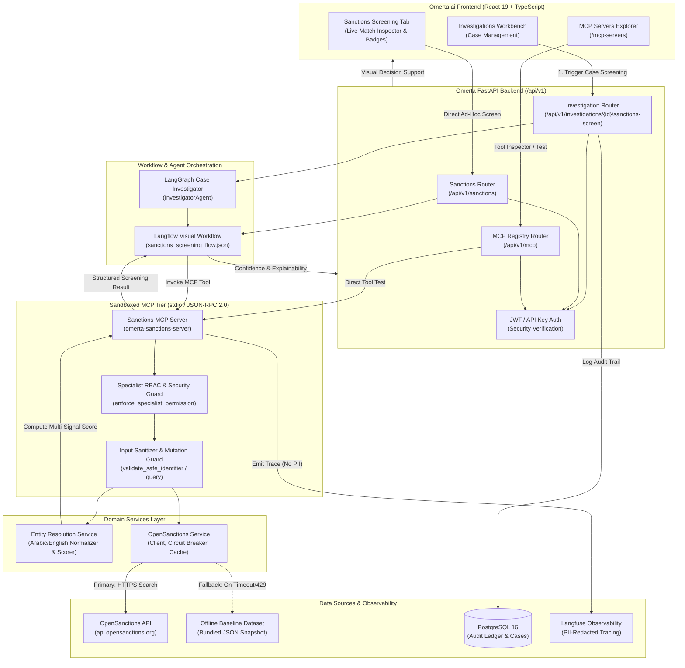
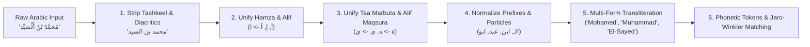
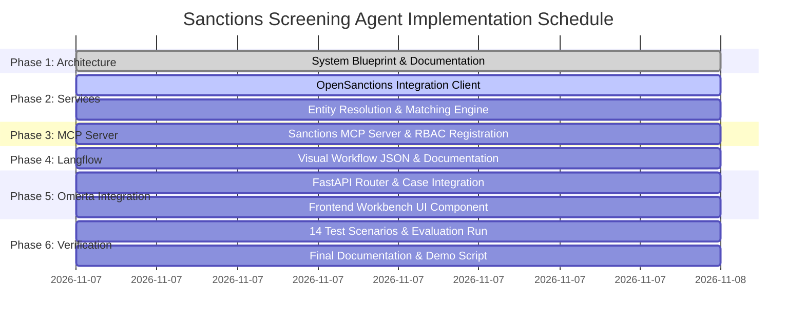

# Omerta.ai — Sanctions & Watchlist Screening Agent
## Architecture Specification & System Blueprint

**Document Version:** 1.0.0  
**Status:** Approved Architecture Blueprint  
**Classification:** Technical / Security Architecture  
**Target Systems:** Omerta.ai Platform, FastAPI Backend, Langflow Orchestration, Model Context Protocol (MCP), OpenSanctions Data Pipeline  

---

## 1. Executive Summary & Business Context

### 1.1 Business Problem
Financial institutions, payment platforms, and intelligence units are legally mandated to prevent sanctioned individuals, terrorist organizations, and proliferation financiers from accessing financial infrastructure. Regulatory frameworks including **FATF Recommendations 6 & 7**, **OFAC** (US Treasury), **UN Security Council Consolidated Lists**, **EU Financial Sanctions (CFSP)**, and **UK OFSI** require financial crime compliance (FCC) programs to screen customers, counterparties, and transactions against global watchlists.

Legacy sanctions screening systems suffer from three critical architectural flaws:
1. **High False Positive Rates**: Over-reliance on naive string matching causes alert volumes exceeding 95% false positives, burying genuine risks and overwhelming compliance teams.
2. **Cross-Lingual Transliteration Divergence**: Arabic, Cyrillic, and Asian names undergo varied transliterations into Latin script (e.g., *Mohamed*, *Muhammad*, *Mohammad*, *Ahmad*, *Ahmed*, *El-Sayed*, *Al-Sayed*). Simple phonetic or keyword algorithms fail to bridge these orthographic gaps.
3. **Brittle Integration & Premature Automation**: Automated systems that freeze accounts without contextual human review violate customer rights and cause legal liability, while monolithic screening engines prevent modular multi-agent investigations.

### 1.2 The Omerta.ai Solution
The **Sanctions & Watchlist Screening Agent** introduces an agentic, explainable, and multi-signal screening subsystem into Omerta.ai. Built on:
- **Model Context Protocol (MCP)**: A sandboxed, strictly read-only screening server (`omerta-sanctions-server`) exposing `screen_entity_against_watchlists`.
- **OpenSanctions Integration**: Access to open-source, continuously updated international watchlist datasets spanning OFAC, UN, EU, UK, INTERPOL, and PEP registries.
- **Entity Resolution Engine**: Cross-lingual Arabic and English name normalization, alias expansion, and multi-signal scoring (name similarity, identifier agreement, date of birth, and nationality).
- **Langflow Visual Workflow Orchestration**: Visual, auditable, and configurable workflow defining step-by-step entity resolution and explainability generation.
- **Strict Human-in-the-Loop (HITL) Guardrails**: Architectural guarantee that screening results produce confidence-scored review alerts (`review_required=True`) and never trigger unilateral account freezing or automated sanctions confirmations.

---

## 2. System Architecture & Component Diagram

### 2.1 High-Level Architecture Diagram



---

## 3. Core Architectural Principles & Invariants

| Principle | Architectural Enforcement |
|:---|:---|
| **Strictly Read-Only** | The Sanctions MCP Server holds zero mutation capabilities. Database operations are strictly SELECT-only via isolated read roles; upstream OpenSanctions calls are HTTP GET/POST search queries. Prohibited SQL, Cypher, and shell verbs are blocked before execution. |
| **Fail-Closed RBAC** | Anonymous callers are rejected with `AUTHENTICATION_REQUIRED`. Only verified specialist agents (`SanctionsScreeningAgent`, `InvestigatorAgent`, `Orchestrator`) bearing signed HMAC-SHA256 tokens can invoke the tool. |
| **Human-in-the-Loop (HITL)** | A potential sanctions match produces an advisory finding with `review_required=True`. The system **never** freezes accounts, alters customer status, or files SARs automatically. Final disposition belongs exclusively to the Compliance Officer. |
| **Explainable Multi-Signal Scoring** | Results are broken down into transparent constituent factors: primary name similarity, alias agreement, date-of-birth consistency, and country/jurisdiction alignment. The agent outputs exact matched, conflicting, and missing attributes. |
| **Zero-Network Resilience** | If the external OpenSanctions API is rate-limited (HTTP 429), times out, or the environment operates in an air-gapped deployment, the agent degrades seamlessly to a bundled local watchlist dataset without crashing. |
| **PII Redaction in Tracing** | Langfuse tracing records execution latency, match counts, and confidence scores, but redacts national ID numbers, tax identifiers, and full customer addresses. |

---

## 4. Component Responsibilities

### 4.1 Frontend Workbench (`frontend/src/`)
- **Investigation Workspace Integration**: Integrates into the existing `InvestigationsPage.tsx` under a dedicated **Sanctions & Watchlist Screening** card.
- **Participant Entity Extraction**: Automatically extracts the case customer, counterparties, and transaction recipients for one-click batch screening.
- **Explainability Visualization**: Visualizes matched fields (green badges), conflicting fields (red/orange badges), missing fields (gray badges), and external source citation URLs.
- **HITL Advisory Banner**: Alerts the compliance investigator that matching results require human adjudication before adverse action.

### 4.2 FastAPI Layer (`apps/api/v1/`)
- **`apps/api/v1/sanctions.py`**:
  - `POST /api/v1/sanctions/screen`: Direct endpoint for ad-hoc entity screening.
  - `POST /api/v1/investigations/{case_id}/sanctions-screen`: Extracts entities associated with a specific investigation case, runs screening, logs findings, and persists an audit event.
  - `GET /api/v1/sanctions/health`: Reports status of OpenSanctions connectivity, local dataset availability, and cache metrics.
- **`apps/api/v1/mcp.py`**:
  - Registers `omerta-sanctions-server` within the central MCP server registry (`SERVERS_REGISTRY`).

### 4.3 Langflow Workflow & Execution Bridge (`langflow/`)
- **`langflow/components/omerta_sanctions_bridge.py`**:
  - Implements `OmertaSanctionsBridgeComponent` inheriting from `lfx.custom.Component`.
  - Bridges Langflow Studio's visual execution environment to Omerta's authenticated FastAPI backend (`POST /api/v1/sanctions/screen`).
  - Dispatches validated parameters (`entity_name`, `entity_type`, `country`, `birth_date`, `identification_number`, `threshold`) using standard bearer authentication.
  - Transparently preserves result provenance (`CACHE`, `LOCAL_BASELINE`, `OPENSANCTIONS_API`), confidence scoring, factor breakdowns, and mandatory `review_required: True`.
  - Robustly handles connection errors (`BACKEND_UNAVAILABLE`), timeouts (`TIMEOUT`), and HTTP status codes (`HTTP_400`, `HTTP_401`, `HTTP_402`, `HTTP_500`).
- **`langflow/sanctions_screening_flow.json`**:
  - Visual directed acyclic workflow for Langflow Studio containing 6 executable component vertices:
    1. *Investigation Entity Input (`EntityInputComponent`)*: Ingests screening query parameters.
    2. *Arabic/English Normalizer (`NormalizationComponent`)*: Preprocesses script, strips Tashkeel, normalizes Hamza/Alif variants.
    3. *MCP Screening Tool (`OmertaSanctionsBridgeComponent`)*: Authenticated bridge invoking Omerta FastAPI and authoritative MCP tool.
    4. *Multi-Signal Scoring & Ranker (`MultiSignalScoringComponent`)*: Evaluates candidate signals against weighted criteria.
    5. *Explainability & HITL Advisor (`ExplainabilityHITLComponent`)*: Generates audit reasoning and enforces human review obligations.
    6. *Screening Audit Report (`ScreeningAuditReportComponent`)*: Formats and produces final structured JSON audit report.

### 4.4 Read-Only Sanctions MCP Server (`mcp_servers/sanctions_server/`)
- **Server Instance**: `omerta-sanctions-server` (version `0.2.0`).
- **Tool Definition**: `screen_entity_against_watchlists`.
- **Security Validation**: Validates inputs via `validate_safe_query` and identifier checks; rejects SQL/Cypher/shell injections.
- **RBAC**: Checks specialist caller identity using `enforce_specialist_permission`.

### 4.5 Domain Services Layer (`domain/services/`)
- **`OpenSanctionsService` (`domain/services/opensanctions_service.py`)**:
  - Encapsulates HTTP client interactions with `https://api.opensanctions.org/match/default` and `/search/default`.
  - Implements exponential backoff with jitter for HTTP 429 and network timeouts.
  - Manages in-memory TTL caching for repeat queries.
  - Provides instant fallback to `infrastructure/opensanctions/data/baseline_sanctions.json` when upstream is unreachable.
- **`EntityResolutionService` (`domain/services/entity_resolution_service.py`)**:
  - Cleans and normalizes English and Arabic text.
  - Performs Arabic diacritic stripping (Tashkeel removal), letter unification (Hamza variations, Alif Maqsura, Taa Marbuta), and prefix detachment (Al-, El-, Abdel-).
  - Calculates composite matching confidence scores using Jaro-Winkler, Levenshtein distance, token sort ratios, and identifier corroboration.

---

## 5. End-to-End Data Flow

```mermaid
sequenceDiagram
    autonumber
    actor Investigator as Compliance Analyst
    participant UI as React Frontend
    participant API as FastAPI Gateway
    participant Orchestrator as Langflow / Investigator
    participant MCP as Sanctions MCP Server
    participant RBAC as Security & RBAC Guard
    participant ER as Entity Resolution Engine
    participant OS as OpenSanctions Service
    participant Remote as api.opensanctions.org
    participant Langfuse as Langfuse Tracing
    participant DB as PostgreSQL Audit Ledger

    Investigator->>UI: Click "Screen Case Entities" (Case #INV-8821)
    UI->>API: POST /api/v1/investigations/INV-8821/sanctions-screen
    API->>API: Authenticate Analyst JWT & Validate Case ID
    API->>DB: Fetch Case Customer & Counterparty Names
    DB-->>API: Customer: "محمد السيد أحمد", Country: "EG", DOB: "1982-05-14"

    API->>Orchestrator: Dispatch Screening Request
    Orchestrator->>MCP: Call tool "screen_entity_against_watchlists"
    Note over MCP,RBAC: Specialist: InvestigatorAgent + HMAC Token
    MCP->>RBAC: enforce_specialist_permission("InvestigatorAgent", "screen_entity_against_watchlists")
    RBAC-->>MCP: Authorized

    MCP->>ER: Normalize Input ("محمد السيد أحمد" -> "mohamed sayed ahmed")
    ER-->>MCP: Normalized Variants & Tokens

    MCP->>OS: Query Watchlists (Name="Mohamed El-Sayed Ahmed", Country="EG")
    alt Remote API Available
        OS->>Remote: POST /match/default (FTM Schema)
        Remote-->>OS: Candidates (OFAC, UN, EU entries)
    else Timeout or 429
        OS->>OS: Fallback to baseline_sanctions.json
    end
    OS-->>MCP: Raw Watchlist Candidate Entities

    MCP->>ER: Score Candidates (Multi-Signal Cross-Match)
    ER->>ER: Compare Names, DOBs, Countries, Identifiers
    ER-->>MCP: Scored Matches + Matched/Conflicting Fields + Explanation

    MCP->>Langfuse: Trace Execution (Latency, Match Count; PII Redacted)
    MCP-->>Orchestrator: Structured Screening Result Payload
    Orchestrator-->>API: Synthesized Investigation Findings

    API->>DB: Persist AuditEvent (CASE_SANCTIONS_SCREENED)
    API-->>UI: Return 200 OK with Match Cards & Confidence Badges
    UI-->>Investigator: Display Matches with HITL Warning & Source Citations
```

---

## 6. Entity Resolution & Multi-Signal Scoring Formulation

Matching confidence is computed deterministically across four orthogonal verification axes:

$$\text{Confidence Score} = w_{\text{name}} \cdot S_{\text{name}} + w_{\text{dob}} \cdot S_{\text{dob}} + w_{\text{country}} \cdot S_{\text{country}} + w_{\text{id}} \cdot S_{\text{id}}$$

### 6.1 Weight Distribution and Signal Thresholds

| Factor | Weight ($w_i$) | Agreement Condition | Evaluation Metric | Penalty for Conflict |
|:---|:---:|:---|:---|:---:|
| **Name Similarity** ($S_{\text{name}}$) | 0.50 | Primary or alias match $\ge 0.75$ | Max(Jaro-Winkler, Token Sort Ratio, Transliteration Match) | Score drops proportionally below 0.70 |
| **Date of Birth** ($S_{\text{dob}}$) | 0.25 | Exact year/month/day agreement | Exact = 1.0; Year-only = 0.6; Missing = 0.0 | **-0.35** if years conflict by $> 2$ years |
| **Country / Nationality** ($S_{\text{country}}$) | 0.15 | ISO-3166 code match | Exact match = 1.0; Mismatch = 0.0; Missing = 0.0 | **-0.20** if explicit different jurisdiction |
| **National / Tax ID** ($S_{\text{id}}$) | 0.10 | Exact identifier string match | Exact match = 1.0; Missing = 0.0 | **-0.30** if IDs conflict |

### 6.2 Decision Matrix & Human-in-the-Loop Flags

| Computed Confidence Score | Preliminary Status | Automated Action | UI Badge | Review Required |
|:---:|:---:|:---:|:---:|:---:|
| $\ge 0.85$ | `POTENTIAL_MATCH` | Flag for Urgent Analyst Review | High Risk (Red) | **True** |
| $0.65 - 0.84$ | `NEEDS_HUMAN_REVIEW` | Queue for Secondary Clearance | Warning (Amber) | **True** |
| $< 0.65$ | `NO_MATCH` | Log Negative Result to Audit | Clear (Green) | **False** |

> [!IMPORTANT]
> **Human Review Obligation**: Regardless of confidence score, no entity record is automatically classified as a confirmed sanctions hit or placed under asset freeze without authenticated sign-off by a designated compliance officer.

---

## 7. Bilingual Arabic & English Normalization Pipeline

Arabic names present unique orthographic variations that defeat naive ASCII matching. The normalization pipeline executes the following stages:



1. **Tashkeel Stripping**: Removes Fatha, Damma, Kasra, Sukun, Shadda, and Tanween (`[\u064B-\u065F\u0670]`).
2. **Orthographic Normalization**:
   - `أ`, `إ`, `آ`, `ٱ` $\rightarrow$ `ا` (Bare Alif)
   - `ة` $\rightarrow$ `ه` (Taa Marbuta to Haa)
   - `ى` $\rightarrow$ `ي` (Alif Maqsura to Yaa)
3. **Prefix Normalization**:
   - Strips definite article `ال` (*Al-* / *El-*), `عبد` (*Abdel-* / *Abdul-*), `ابن` (*Ibn* / *Bin*), ensuring names like "السيد" match "سيد" and "El-Sayed".
4. **Phonetic & Latin Transliteration Equivalences**:
   - Maps Arabic phonetic stems to standard Latin variants (*Mohamed* / *Muhammad* / *Mohammad* / *Mahmud*; *Ahmad* / *Ahmed*; *Osama* / *Usama*; *Hussein* / *Hussain*).

---

## 8. Error Handling & Standardized Error Codes

In accordance with Omerta.ai MCP standards, the screening server returns machine-readable error codes:

| Error Code | HTTP / Transport Mapping | Root Cause | Agent Recovery Action |
|:---|:---:|:---|:---|
| `INVALID_INPUT` | 400 Bad Request | Blank name, invalid character sequence, or injection payload. | Reject query; prompt caller for valid entity name. |
| `AUTHENTICATION_FAILED` | 401 Unauthorized | Missing or invalid specialist HMAC token. | Deny access; enforce fail-closed security boundary. |
| `UNAUTHORIZED_TOOL_ACCESS` | 403 Forbidden | Specialist caller lacks permission for `screen_entity_against_watchlists`. | Inform caller to delegate to `SanctionsScreeningAgent` or `InvestigatorAgent`. |
| `RATE_LIMITED` | 429 Too Many Requests | Upstream OpenSanctions API rate limit exceeded. | Execute exponential backoff; switch to local fallback dataset. |
| `REQUEST_TIMEOUT` | 504 Gateway Timeout | Upstream API unresponsive after 8.0s timeout. | Serve results from local cache / baseline dataset with `PARTIAL_RESULTS` flag. |
| `SOURCE_UNAVAILABLE` | 503 Service Unavailable | Upstream endpoint unreachable / DNS failure. | Fail gracefully to offline baseline dataset. |
| `NO_MATCH` | 200 OK (Payload) | Valid search completed; zero entities exceeded threshold. | Return clean payload with `match_found=False`. |
| `PARTIAL_RESULTS` | 200 OK (Payload) | Primary source timed out; returned results from offline baseline. | Include warning in execution metadata for compliance audit. |
| `INTERNAL_ERROR` | 500 Internal Error | Unexpected unhandled exception in processing engine. | Log sanitized stack trace; return generic error without leaking internals. |

---

## 9. Security, Governance & Audit Logging

1. **Defense Against Prompt Injection**:
   Watchlist entries contain untrusted external text. All returned names, notes, and citations are sanitized before being fed into LangGraph / Langflow prompts to prevent indirect prompt injection.
2. **SQL / Cypher / Command Injection Defense**:
   All entity identifiers and search parameters pass through `validate_safe_query` and `validate_safe_identifier`. Direct SQL or Cypher concatenation is prohibited.
3. **Audit Immutability**:
   Every screening execution records an immutable `AuditEvent` in PostgreSQL with:
   - `action`: `CASE_SANCTIONS_SCREENED` or `ENTITY_SANCTIONS_SCREENED`
   - `user_id`: Authenticated investigator ID
   - `case_id`: Associated investigation case external ID
   - `metadata`: Candidate counts, highest confidence score, and timestamp.
4. **Langfuse Tracing**:
   Langfuse traces capture:
   - Trace Name: `sanctions_screening`
   - Spans: `input_normalization`, `mcp_tool_execution`, `entity_resolution`, `upstream_query`
   - Redacted: National identity numbers, phone numbers, and street addresses.

---

## 10. Implementation Roadmap



---
*Signed off by: Senior AI Infrastructure Engineer & MCP Architect, Omerta.ai*

