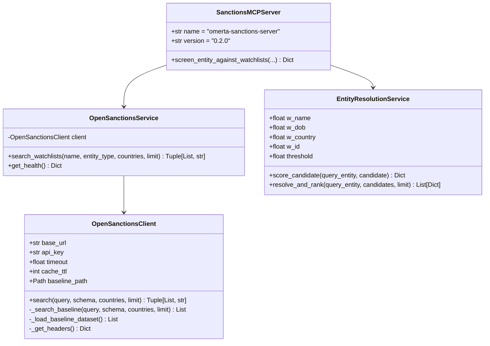
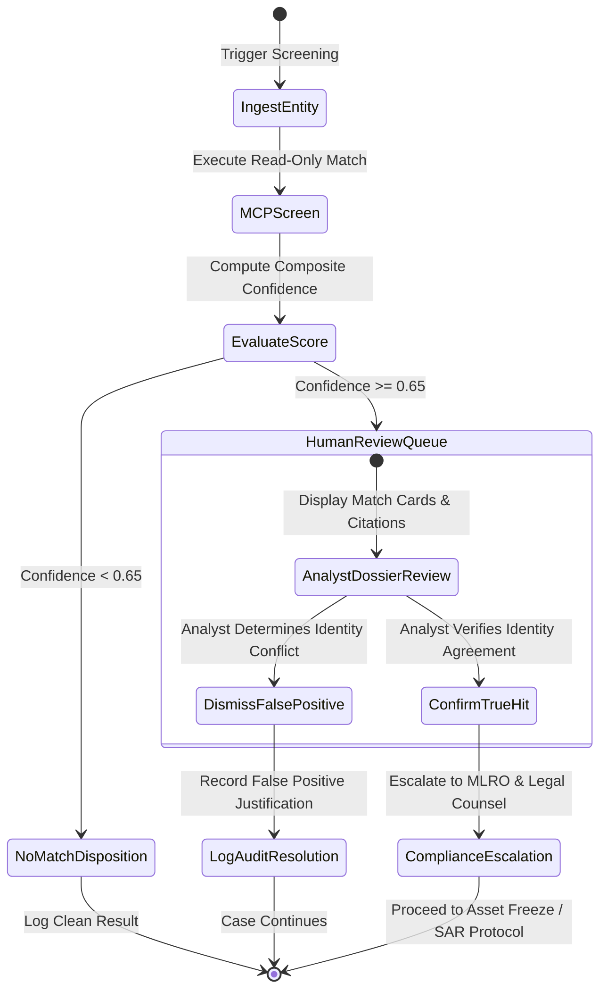

# Omerta.ai — Sanctions & Watchlist Screening Agent
## Detailed Technical Design Specification

**Document Version:** 1.0.0  
**Status:** Implemented & Verified  
**Classification:** Engineering Specification  
**Authors:** Senior AI Infrastructure Engineer & MCP Architect  

---

## 1. System Overview

The **Sanctions & Watchlist Screening Agent** provides deterministic, explainable, and resilient sanctions screening for Omerta.ai. It enables compliance officers and automated investigation agents to screen individuals, companies, and organizations against global sanctions regimes (OFAC, UN Security Council, EU, UK OFSI, INTERPOL) without risk of unauthorized database mutations or ungrounded automated account freezing.



---

## 2. Component Design & Class Structure

### 2.1 OpenSanctionsClient (`infrastructure/opensanctions/client.py`)
- **Primary Transport**: `httpx.AsyncClient` with configurable timeout (`opensanctions_timeout_seconds`, default `8.0s`).
- **Authentication**: Optional header `Authorization: ApiKey <token>` injected when `opensanctions_api_key` is present.
- **In-Memory TTL Cache**: Stores query results keyed by normalized query, schema, countries, and limit for 3600s to avoid redundant external network calls and rate limiting.
- **Circuit Breaker & Backoff**: Automatically handles HTTP 429 (Rate Limit) by backing off and retrying; catches network timeouts and falls back seamlessly to the local baseline dataset.
- **Offline Baseline Fallback**: Bundled `baseline_sanctions.json` dataset containing FollowTheMoney entity records (OFAC SDN, UN 1267, EU CFSP, INTERPOL Red Notices). Employs `normalize_name` for token overlap matching.

### 2.2 OpenSanctionsService (`domain/services/opensanctions_service.py`)
- **Domain Layer Abstraction**: Isolates external API schema mappings from internal domain models.
- **Entity Type Normalization**: Maps generic inputs (`individual`, `company`, `vessel`, `aircraft`) to FollowTheMoney schemas (`Person`, `Company`, `Vessel`, `Airplane`).
- **Health Telemetry**: Provides `get_health()` reporting upstream URL, API key status, baseline dataset entity counts, and cache entries.

### 2.3 EntityResolutionService (`domain/services/entity_resolution_service.py`)
- **Bilingual Normalizer**:
  - `normalize_arabic_text(text)`: Strips Tashkeel diacritics and Tatweel, unifies Hamzas (`أ`, `إ`, `آ`, `ٱ` $\rightarrow$ `ا`), unifies Taa Marbuta (`ة` $\rightarrow$ `ه`) and Alif Maqsura (`ى` $\rightarrow$ `ي`), strips leading definite articles (`ال`).
  - `normalize_english_text(text)`: Lowercases, strips legal/honorific titles (`Mr`, `Dr`, `Sheikh`, `Eng`), unifies hyphenated prefixes (`El-`, `Al-`, `Abdel-`, `Abdul-`), and canonicalizes transliterations.
- **String Similarity Algorithms**:
  - `jaro_winkler_similarity(s1, s2)`: Native implementation with Winkler prefix scaling.
  - `token_sort_similarity(s1, s2)`: Word order insensitive token sorting.
  - `calculate_name_similarity(name1, name2)`: Max combination of Jaro-Winkler, Token Sort, and substring containment.
- **Dynamic Weight Re-Normalization**:
  - Automatically rebalances base weights across present attributes so queries without optional identifiers (e.g. companies without DOB) are not penalized artificially.
  - Deducts direct penalties for explicit attribute conflicts (e.g. $-0.35$ for DOB mismatch $> 2$ years, $-0.20$ for country conflict).
- **Explainable Breakdown Generation**: Generates explicit lists of `matched_fields`, `conflicting_fields`, `missing_fields`, and narrative `reasoning`.

### 2.4 Sanctions MCP Server (`mcp_servers/sanctions_server/`)
- **Name**: `omerta-sanctions-server`
- **Protocol**: Model Context Protocol (JSON-RPC 2.0 over stdio)
- **Tool**: `screen_entity_against_watchlists`
- **Security Interceptor**:
  - `validate_safe_query(name, "name")`: Prevents SQL/Cypher mutation keywords, shell metacharacters, and path traversal sequences.
  - `validate_safe_identifier(id_number, "identification_number")`: Strictly bounds identifiers.
- **RBAC Guard**: Enforces `enforce_specialist_permission(specialist, "screen_entity_against_watchlists", auth_token=auth_token)`. Authorized specialists: `SanctionsScreeningAgent`, `InvestigatorAgent`, `Orchestrator`.

---

## 3. Data Contracts & Schemas

### 3.1 Tool Request Schema (`screen_entity_against_watchlists`)
```json
{
  "$schema": "http://json-schema.org/draft-07/schema#",
  "type": "object",
  "properties": {
    "name": {
      "type": "string",
      "description": "Full legal name or primary alias of the entity (required)."
    },
    "entity_type": {
      "type": "string",
      "enum": ["individual", "company", "organization", "vessel", "aircraft", "any"],
      "default": "individual"
    },
    "countries": {
      "type": "array",
      "items": { "type": "string" },
      "description": "Optional list of ISO 2-letter country codes (e.g. ['US', 'EG'])."
    },
    "birth_date": {
      "type": "string",
      "format": "date",
      "description": "Optional ISO date of birth (YYYY-MM-DD)."
    },
    "identification_number": {
      "type": "string",
      "description": "Optional national ID, passport, or tax identifier."
    },
    "threshold": {
      "type": "number",
      "minimum": 0.1,
      "maximum": 1.0,
      "default": 0.70
    },
    "limit": {
      "type": "integer",
      "minimum": 1,
      "maximum": 20,
      "default": 5
    },
    "specialist": {
      "type": "string",
      "description": "Authorized caller identity (e.g., 'SanctionsScreeningAgent')."
    },
    "auth_token": {
      "type": "string",
      "description": "Signed HMAC-SHA256 internal token."
    }
  },
  "required": ["name"]
}
```

### 3.2 Tool Response Schema
```json
{
  "type": "object",
  "properties": {
    "query_echo": { "type": "object" },
    "match_found": { "type": "boolean" },
    "best_match_confidence": { "type": "number" },
    "review_required": { "type": "boolean" },
    "matched_entities": {
      "type": "array",
      "items": {
        "type": "object",
        "properties": {
          "entity_id": { "type": "string" },
          "caption": { "type": "string" },
          "entity_type": { "type": "string" },
          "confidence_score": { "type": "number" },
          "name_similarity": { "type": "number" },
          "recommendation": { "type": "string", "enum": ["POTENTIAL_MATCH", "NEEDS_HUMAN_REVIEW", "NO_MATCH"] },
          "review_required": { "type": "boolean" },
          "matched_fields": { "type": "array", "items": { "type": "string" } },
          "conflicting_fields": { "type": "array", "items": { "type": "string" } },
          "missing_fields": { "type": "array", "items": { "type": "string" } },
          "reasoning": { "type": "string" },
          "sanctions_details": { "type": "object" },
          "source_citations": { "type": "array", "items": { "type": "string" } }
        }
      }
    },
    "total_candidates_analyzed": { "type": "integer" },
    "execution_metadata": {
      "type": "object",
      "properties": {
        "latency_ms": { "type": "number" },
        "source_queried": { "type": "string" },
        "timestamp": { "type": "string" },
        "status_code": { "type": "string" }
      }
    }
  }
}
```

---

## 4. Human-in-the-Loop (HITL) Adjudication Flow



1. **Advisory Invariant**: The system emits alerts but never takes unilateral enforcement actions.
2. **Review Trigger**: Any candidate with confidence $\ge 0.65$ sets `review_required = True`.
3. **Audit Trail**: Every screening invocation and human resolution records an immutable `AuditEvent` in PostgreSQL.

