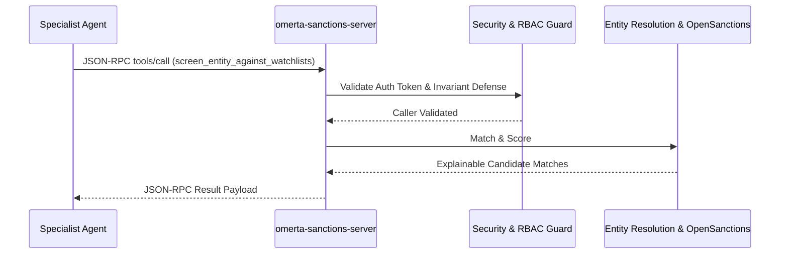

# Omerta.ai — Sanctions MCP Server
## Formal Tool Specification: `screen_entity_against_watchlists`

**Server Name:** `omerta-sanctions-server`  
**Server Version:** `0.2.0`  
**Protocol:** Model Context Protocol (JSON-RPC 2.0)  
**Security Scope:** Strictly Read-Only (NOSUPERUSER, SELECT-Only, Mutation-Blocked)  

---

## 1. Tool Overview

`screen_entity_against_watchlists` is a sandboxed, strictly read-only MCP tool that performs cross-lingual entity resolution and watchlist screening over international sanctions lists (OFAC SDN, UN Consolidated Lists, EU CFSP, UK HMT, INTERPOL).



---

## 2. Input Parameter Specification

| Parameter | Type | Required | Default | Constraints | Description |
|:---|:---:|:---:|:---:|:---|:---|
| `name` | string | **Yes** | — | Min: 1, Max: 256 chars. No shell/SQL verbs. | Full legal name or known alias of the entity to screen. Supports Arabic and English script. |
| `entity_type` | string | No | `"individual"` | Enum: `individual`, `company`, `organization`, `vessel`, `aircraft`, `any` | Category of entity to screen. |
| `countries` | array[string] | No | `[]` | List of 2-letter ISO 3166-1 alpha-2 codes (e.g. `["EG", "US"]`). | Known countries of citizenship, registration, or operation. |
| `birth_date` | string | No | `null` | ISO 8601 date: `YYYY-MM-DD` | Date of birth for individuals. |
| `identification_number` | string | No | `null` | Max: 64 chars. Safe identifier regex. | National identification number, tax ID, or passport number. |
| `threshold` | float | No | `0.70` | Range: `[0.10, 1.00]` | Minimum confidence score to report a candidate match. |
| `limit` | integer | No | `5` | Range: `[1, 20]` | Maximum number of ranked candidate records to return. |
| `specialist` | string | **Yes\*** | `null` | Must match RBAC allowlist. | Authorized specialist agent identity (`SanctionsScreeningAgent`, `InvestigatorAgent`, `Orchestrator`). |
| `auth_token` | string | **Yes\*** | `null` | Valid HMAC-SHA256 signature string. | Signed token generated via `generate_specialist_token()`. |

*\* Mandatory under Phase 2 MCP security hardening. Anonymous calls are rejected fail-closed.*

---

## 3. Output Schema Specification

### Top-Level Fields

| Field | Type | Description |
|:---|:---:|:---|
| `query_echo` | object | Echo of sanitized input parameters used during query execution. |
| `match_found` | boolean | `true` if at least one candidate met or exceeded the confidence threshold. |
| `best_match_confidence` | float | Confidence score of the top-ranked candidate (`0.00` to `1.00`). |
| `review_required` | boolean | **Always true** if `match_found` is true (enforces Human-in-the-Loop compliance). |
| `matched_entities` | array[object] | List of candidate match objects ranked in descending order of confidence. |
| `total_candidates_analyzed`| integer | Total raw entities evaluated from the watchlist source. |
| `execution_metadata` | object | Operational telemetry including latency in milliseconds and source queried. |

### `matched_entities` Item Schema

```json
{
  "entity_id": "string",
  "caption": "string",
  "entity_type": "string",
  "confidence_score": 0.95,
  "name_similarity": 1.0,
  "recommendation": "POTENTIAL_MATCH",
  "review_required": true,
  "matched_fields": ["array of factor strings"],
  "conflicting_fields": ["array of conflict strings"],
  "missing_fields": ["array of missing attribute strings"],
  "reasoning": "string",
  "sanctions_details": {
    "datasets": ["us_ofac_sdn", "un_sc_sanctions"],
    "sanctions_programs": ["string"],
    "topics": ["sanction"],
    "notes": ["string"]
  },
  "source_citations": ["array of official URLs"]
}
```

---

## 4. Standard Error Codes & Recovery Matrix

| Error Code | HTTP Status | Trigger Condition | Recovery Guidance |
|:---|:---:|:---|:---|
| `INVALID_INPUT` | 400 | Name is empty, parameter exceeds length, or invalid data types. | Provide a non-empty name string conforming to length boundaries. |
| `SECURITY_VIOLATION` | 400 | Injection pattern detected (e.g. `DROP TABLE`, shell pipes, backticks). | Sanctions screening is strictly read-only. Remove SQL/Cypher mutation keywords and shell metacharacters. |
| `AUTHENTICATION_REQUIRED` | 401 | Anonymous caller or missing/invalid specialist authentication token. | Callers must provide an authorized specialist identity with signed HMAC token. |
| `UNAUTHORIZED_TOOL_ACCESS` | 403 | Specialist agent lacks permission for `screen_entity_against_watchlists`. | Delegate tool call to `SanctionsScreeningAgent`, `InvestigatorAgent`, or `Orchestrator`. |
| `RATE_LIMITED` | 429 | Upstream OpenSanctions API rate limit exceeded. | Execute exponential backoff; the server automatically falls back to the baseline dataset. |
| `REQUEST_TIMEOUT` | 504 | Upstream API unresponsive after 8.0s timeout. | The server automatically serves cached or offline baseline results with `PARTIAL_RESULTS`. |
| `SOURCE_UNAVAILABLE` | 503 | Upstream service down and baseline dataset missing. | Verify local dataset file existence in `infrastructure/opensanctions/data/`. |
| `INTERNAL_ERROR` | 500 | Unhandled internal exception. | Check server log; stack traces are sanitized from the client response. |

---

## 5. Example Invocations

### 5.1 JSON-RPC Request: Person Screening with Transliteration
```json
{
  "jsonrpc": "2.0",
  "id": "req-001",
  "method": "tools/call",
  "params": {
    "name": "screen_entity_against_watchlists",
    "arguments": {
      "name": "Muhammad Al-Sayed Ahmad",
      "entity_type": "individual",
      "countries": ["EG"],
      "birth_date": "1982-05-14",
      "specialist": "SanctionsScreeningAgent",
      "auth_token": "mcp_v1.SanctionsScreeningAgent.ef9a33cdf9ab71dcbce2bb64c87d10aa966b9be3b47792ebcdf637ba061b0102"
    }
  }
}
```

### 5.2 JSON-RPC Response: High Confidence Hit
```json
{
  "jsonrpc": "2.0",
  "id": "req-001",
  "result": {
    "query_echo": {
      "name": "Muhammad Al-Sayed Ahmad",
      "entity_type": "individual",
      "countries": ["EG"],
      "birth_date": "1982-05-14",
      "identification_number": null,
      "threshold": 0.70
    },
    "match_found": true,
    "best_match_confidence": 0.948,
    "review_required": true,
    "matched_entities": [
      {
        "entity_id": "os-person-001",
        "caption": "Mohamed El-Sayed Ahmed",
        "entity_type": "Person",
        "confidence_score": 0.948,
        "name_similarity": 0.948,
        "recommendation": "POTENTIAL_MATCH",
        "review_required": true,
        "matched_fields": [
          "Name match: 'Muhammad Al-Sayed Ahmad' ~ 'Mohamed El-Sayed Ahmed' (similarity: 0.95)",
          "Date of birth exact match: 1982-05-14",
          "Country match: EG"
        ],
        "conflicting_fields": [],
        "missing_fields": [
          "Identification number not provided in query"
        ],
        "reasoning": "HIGH CONFIDENCE MATCH (94.8%): Entity 'Muhammad Al-Sayed Ahmad' strongly aligns with sanctioned record 'Mohamed El-Sayed Ahmed' on programs: OFAC SDN - [SDGT] Specially Designated Global Terrorist, UN Security Council ISIL (Da'esh) and Al-Qaida Sanctions List. Corroborated by 3 matching factors. Immediate compliance review required.",
        "sanctions_details": {
          "datasets": ["us_ofac_sdn", "un_sc_sanctions"],
          "sanctions_programs": [
            "OFAC SDN - [SDGT] Specially Designated Global Terrorist",
            "UN Security Council ISIL (Da'esh) and Al-Qaida Sanctions List"
          ],
          "topics": ["sanction"]
        },
        "source_citations": [
          "https://www.opensanctions.org/entities/os-person-001/",
          "https://sanctionssearch.ofac.treas.gov/Details.aspx?id=102931"
        ]
      }
    ],
    "total_candidates_analyzed": 8,
    "execution_metadata": {
      "latency_ms": 11.4,
      "source_queried": "LOCAL_BASELINE",
      "timestamp": "2026-11-07T07:44:32.102918+00:00",
      "status_code": "MATCH_FOUND"
    }
  }
}
```

