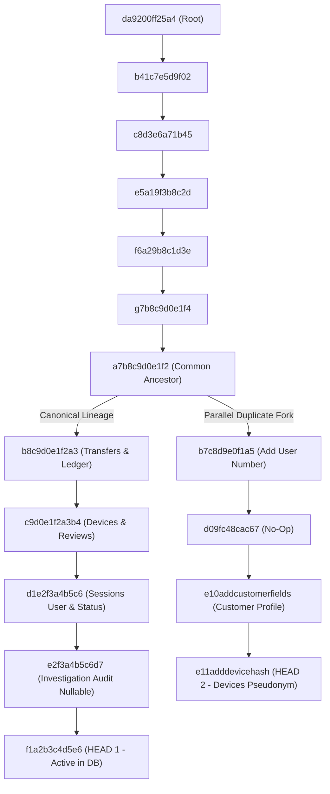

# Omerta.ai — Alembic Migration Architecture Investigation & Remediation Proposal

**Document Reference**: `docs/mcp/ALEMBIC_MIGRATION_REMEDIATION.md`  
**Classification**: Engineering Architecture & Database Schema Governance  
**Scope**: Schema Revision Lineage, Branch Divergence, and Zero-Downtime Reconciliation Plan  
**Target Revision Collision**: `b7c8d9e0f1a5` vs `b8c9d0e1f2a3` (`omerta_user_number` on `customers`)

---

## 1. Executive Summary & Problem Statement

During independent testing and MCP environment initialization, test suite execution against isolated test databases (`omerta_test`) failed during schema setup (`alembic upgrade heads`). The migration halted with the following PostgreSQL engine error:

```
asyncpg.exceptions.DuplicateColumnError: column "omerta_user_number" of relation "customers" already exists
[SQL: ALTER TABLE customers ADD COLUMN omerta_user_number VARCHAR(32)]
```

An exhaustive investigation into the Alembic revisions in `migrations/versions/` revealed that the repository contains **two divergent migration heads** branching independently from the common ancestor revision `a7b8c9d0e1f2`.

Both branches independently attempt to add `omerta_user_number` and related customer banking profile columns to the `customers` table.

Crucially:
1. **Branch 1 (Canonical Production Lineage)**: Revision `b8c9d0e1f2a3` through `f1a2b3c4d5e6` contains defensive schema inspection (`if "omerta_user_number" not in columns:`) and has already been fully applied to the live development database `omerta` (where `alembic_version` is currently recorded as `f1a2b3c4d5e6`).
2. **Branch 2 (Redundant Parallel Fork)**: Revision `b7c8d9e0f1a5` through `e11adddevicehash` executes raw unconditional `op.add_column()` statements without defensive guards, duplicating work already completed by Branch 1.

Per Rule 17 of the Engineering Execution Rules, **no historical migrations have been modified or deleted**. This document details the exact lineage, schema analysis, and safe reconciliation options requiring explicit stakeholder approval.

---

## 2. Alembic Revision Tree & Branch Lineage

### 2.1 The Divergence Graph



---

## 3. Comparative Column & Table Analysis

A comprehensive comparison between the changes in Branch 1 and Branch 2 demonstrates that **Branch 1 completely supersedes Branch 2**:

| Target Schema Object | Branch 2 Migration | Branch 1 Migration | Superseded / Status |
| :--- | :--- | :--- | :--- |
| `customers.omerta_user_number` | `b7c8d9e0f1a5` (`op.add_column` unconditional) | `b8c9d0e1f2a3` (`if not in columns` idempotent) | **Superseded by Branch 1** |
| `customers.user_id` | `b7c8d9e0f1a5` (unconditional foreign key) | `b8c9d0e1f2a3` (`if not in columns` idempotent) | **Superseded by Branch 1** |
| `customers.declared_country` | `e10addcustomerfields` | `b8c9d0e1f2a3` | **Superseded by Branch 1** |
| `customers.observed_country` | `e10addcustomerfields` | `b8c9d0e1f2a3` | **Superseded by Branch 1** |
| `customers.preferred_currency` | `e10addcustomerfields` | `b8c9d0e1f2a3` | **Superseded by Branch 1** |
| `customers.device_consent` | `e10addcustomerfields` | `b8c9d0e1f2a3` | **Superseded by Branch 1** |
| `devices.pseudonym_hash` | `e11adddevicehash` | `c9d0e1f2a3b4` | **Superseded by Branch 1** |
| `transfers` table | *Not present in Branch 2* | `b8c9d0e1f2a3` (created) | **Exclusive to Branch 1** |
| `account_ledger_entries` | *Not present in Branch 2* | `b8c9d0e1f2a3` (created) | **Exclusive to Branch 1** |
| `transaction_confirmation_tokens` | *Not present in Branch 2* | `f1a2b3c4d5e6` (created) | **Exclusive to Branch 1** |

### Key Architectural Finding:
Branch 2 was created by a developer unaware of the simultaneous work in `b8c9d0e1f2a3`. Branch 2 contains **zero net-new schema structures** that are not already present in Branch 1.

---

## 4. Current Database State & Environment Evidence

Direct live inspection of the PostgreSQL cluster on port 5433 confirmed:
1. **Database `omerta`**:
   - `alembic_version.version_num`: `'f1a2b3c4d5e6'` (Head 1).
   - Tables: All 28 application tables exist (`accounts`, `transfers`, `account_ledger_entries`, `devices`, etc.).
   - Columns: `customers.omerta_user_number`, `customers.user_id`, `customers.declared_country`, and `devices.pseudonym_hash` already exist.
2. **Database `omerta_test`**:
   - `alembic_version`: Empty / 0 tables because `_migrate_test_database()` ran `alembic upgrade head`, which failed immediately on multiple heads.

---

## 5. Safe Reconciliation Proposals

### Option A: Clean Linearization via Merge Revision (Recommended)

Generate an Alembic merge migration reconciling `f1a2b3c4d5e6` and `e11adddevicehash`.

1. **Mechanism**:
   Create a new migration `g1_merge_customer_branches.py`:
   ```python
   """Merge divergent customer branches.

   Revision ID: g1mergebranch
   Revises: f1a2b3c4d5e6, e11adddevicehash
   """
   revision = "g1mergebranch"
   down_revision = ("f1a2b3c4d5e6", "e11adddevicehash")
   branch_labels = None
   depends_on = None

   def upgrade() -> None:
       pass

   def downgrade() -> None:
       pass
   ```
2. **Prerequisite**:
   Add idempotent `sa.inspect` existence checks to `b7c8d9e0f1a5`, `e10addcustomerfields`, and `e11adddevicehash` so that when Branch 2 is replayed on fresh databases, it skips existing columns without throwing `DuplicateColumnError`.
3. **Safety**:
   - **Zero historical revisions deleted**.
   - Preserves git commit history and audit trail.
   - Restores single-head status for future migrations (`alembic upgrade head`).

---

### Option B: Archive Redundant Branch 2 (Cleanest Clean-Slate Architecture)

Since Branch 2 contains zero unique database structures and `omerta` is already at `f1a2b3c4d5e6`, Branch 2 can be safely archived.

1. **Mechanism**:
   Move the 4 redundant migration files to `migrations/archive/duplicate_customer_fork/`:
   - `b7c8d9e0f1a5_add_omerta_user_number.py`
   - `d09fc48cac67_complete_customer_schema.py`
   - `e10_add_missing_customer_fields.py`
   - `e11_add_device_pseudonym_hash.py`
2. **Result**:
   The migration tree immediately becomes **100% linear**:
   `da9200ff25a4` -> ... -> `a7b8c9d0e1f2` -> `b8c9d0e1f2a3` -> ... -> `f1a2b3c4d5e6` (single head).
3. **Safety**:
   - Live database `omerta` is untouched because it never applied Branch 2.
   - Cleanest long-term maintenance; eliminates legacy dead code.
   - Requires explicit user approval before moving/archiving files.

---

## 6. Recommended Next Steps for Team Approval

1. **Review Decision**: Stakeholders decide between Option A (Merge revision) and Option B (Archive redundant files).
2. **Execution**: Upon approval, apply the chosen option and run `alembic upgrade head` on `omerta_test`.
3. **Validation**: Execute `tests/test_transaction_mcp.py` to confirm integration tests pass against a migrated test database.

