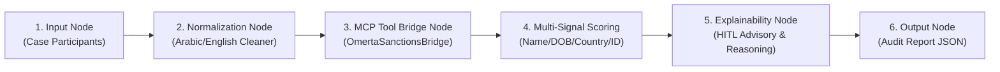

# Omerta.ai — Sanctions & Watchlist Screening Langflow Workflow

This directory contains the visual workflow specification and custom execution bridge component for orchestrating Omerta's **Sanctions & Watchlist Screening Agent** within Langflow.

---

## 1. Workflow Architecture & Nodes

The workflow executes as a directed acyclic graph (DAG) across 6 pipeline stages:



### Complete End-to-End Execution Trace

```
Langflow Canvas / Playground
          │
          ▼
OmertaSanctionsBridgeComponent (langflow/components/omerta_sanctions_bridge.py)
          │
          ▼ (Authenticated HTTP POST with Bearer JWT)
Omerta FastAPI Gateway (apps/api/v1/sanctions.py -> POST /api/v1/sanctions/screen)
          │
          ▼ (Internal signed HMAC token: SanctionsScreeningAgent)
MCP Screening Tool (mcp_servers/sanctions_server/tools.py -> screen_entity_against_watchlists)
          │
          ▼
OpenSanctions Client & Local Baseline Fallback (infrastructure/opensanctions/client.py)
          │
          ▼
Entity Resolution Engine (domain/services/entity_resolution_service.py)
          │
          ▼
Structured Compliance Result (review_required: true, provenance: CACHE / LOCAL_BASELINE)
```

---

## 2. Node-to-Code Mapping

| Node ID | Display Name | Underlying Implementation | Function / Responsibility |
|:---|:---|:---|:---|
| `node_input_entity` | **Investigation Entity Input** | `EntityInputComponent` (`lfx.custom.Component`) | Ingests entity name, type, country, DOB, and ID numbers. |
| `node_normalize` | **Arabic/English Normalizer** | `NormalizationComponent` (`lfx.custom.Component`) | Strips Tashkeel, normalizes Hamza/Alif variants, handles prefixes (`El-`, `Al-`), and normalizes Unicode. |
| `node_mcp_tool` | **MCP: screen_entity_against_watchlists** | `OmertaSanctionsBridgeComponent` (`omerta_sanctions_bridge.py`) | Authenticated execution bridge connecting Langflow Studio to Omerta FastAPI and authoritative MCP tool. |
| `node_scoring` | **Multi-Signal Scoring & Ranker** | `MultiSignalScoringComponent` (`lfx.custom.Component`) | Evaluates candidate matches using weighted multi-signal scoring (Name: 0.50, DOB: 0.25, Country: 0.15, ID: 0.10). |
| `node_explainability` | **Explainability & HITL Advisor** | `ExplainabilityHITLComponent` (`lfx.custom.Component`) | Generates transparent audit reasoning and strictly enforces mandatory human-in-the-loop review. |
| `node_output` | **Screening Audit Report** | `ScreeningAuditReportComponent` (`lfx.custom.Component`) | Produces structured compliance JSON payload with decision recommendation and full audit trail. |

---

## 3. Custom Component: `OmertaSanctionsBridgeComponent`

Located at [`langflow/components/omerta_sanctions_bridge.py`](./components/omerta_sanctions_bridge.py).

### Configurable Inputs
- **`input_data`** (`DataInput`, Optional): Upstream payload from previous pipeline stages (e.g. normalization).
- **`entity_name`** (`StrInput`, Required): Full legal name or alias to screen (e.g. `Mohamed El-Sayed Ahmed`).
- **`entity_type`** (`DropdownInput`): `individual`, `company`, `organization`, `vessel`, `aircraft`, `any`.
- **`country`** (`StrInput`): ISO 2-letter country code (e.g. `EG`, `US`).
- **`birth_date`** (`StrInput`): Date of birth (`YYYY-MM-DD`).
- **`identification_number`** (`StrInput`): National ID, Passport, or Tax ID.
- **`threshold`** (`FloatInput`, Default: `0.70`): Minimum confidence threshold (0.10 to 1.00).
- **`endpoint_url`** (`StrInput`, Advanced): FastAPI endpoint (defaults to `http://127.0.0.1:8000/api/v1/sanctions/screen`).
- **`auth_token`** (`SecretStrInput`, Advanced): Optional JWT bearer token. Falls back to `OMERTA_BEARER_TOKEN` or dev authentication.

### Resilient Error Handling
- **`INVALID_INPUT`**: Triggered when `entity_name` is blank or whitespace.
- **`BACKEND_UNAVAILABLE`**: Captured when Omerta backend is offline, returning clean error telemetry without crashing Langflow.
- **`HTTP_401`**: Raised on invalid or expired access tokens.
- **`HTTP_402`**: Captured when external OpenSanctions API returns credit exhaustion; transparently handled by server fallback.
- **`TIMEOUT`**: Managed with a 30-second timeout window.

---

## 4. OpenSanctions Credits & Data Provenance

### HTTP 402 Payment Required Investigation
The configured OpenSanctions API key (`ccd272f6e0fee9de8298d39db9a48762`) returns:
```
HTTP 402 Payment Required: {"detail": "Your organization has run out of API credits."}
```

### Resilient Local Baseline Architecture
Omerta's `OpenSanctionsClient` implements an offline circuit breaker:
1. When credits are exhausted or network is unavailable, queries seamlessly fall back to [`infrastructure/opensanctions/baseline_sanctions.json`](../infrastructure/opensanctions/baseline_sanctions.json).
2. Result provenance is strictly preserved:
   - Results from offline dataset are explicitly labeled `LOCAL_BASELINE` or `CACHE`.
   - Results are never falsely claimed to be live API hits.
3. Once credits are replenished or a new key is supplied, update `.env`:
   ```bash
   OPENSANCTIONS_API_KEY=your_new_api_key_here
   ```

---

## 5. Running and Testing in Langflow Studio

### Starting the Daemon
```powershell
$env:LANGFLOW_AUTO_LOGIN="true"
$env:LANGFLOW_SUPERUSER="admin"
$env:LANGFLOW_SUPERUSER_PASSWORD="admin_password123"
uvx --from langflow-base langflow run --host 127.0.0.1 --port 7860 --no-open-browser
```

### Studio Build & Playground Execution
1. Navigate to `http://127.0.0.1:7860` in your browser.
2. Open flow: **Omerta.ai — Sanctions & Watchlist Screening Flow** (ID: `dbe14518-a4cc-41a4-8e1a-e3514ad34f5c`).
3. Click **Play** on `node_mcp_tool` or open the **Playground**.
4. The workflow will execute all 6 vertices, query the Omerta FastAPI gateway, invoke the MCP tool, and display the structured results.

---

## 6. Automated Verification Suites

Run the dedicated test suites:

```powershell
# 1. Phase 4 Langflow Standalone Execution Suite (11/11 Passing)
.venv\Scripts\pytest.exe tests/test_langflow_execution.py -v

# 2. Sanctions MCP & Screening Verification Suite (24/24 Passing)
.venv\Scripts\pytest.exe tests/mcp/test_sanctions_mcp.py tests/test_sanctions_screening.py -v

# 3. Full MCP Hardened Regression Suite (212/212 Passing)
.venv\Scripts\pytest.exe tests/mcp/ -q
```

---

## 7. Human-in-the-Loop (HITL) Invariant

The sanctions screening engine enforces the core compliance rule:
1. `review_required` is **always True** whenever `match_found` is True.
2. The workflow will **never** automatically execute adverse actions such as freezing customer funds, blocking accounts, or filing regulatory SARs without human compliance officer approval.
